<p align="center">
<picture>
  <source media="(prefers-color-scheme: dark)" srcset="assets/header-dark.svg">
  
</picture>
</p>

<p align="center">
  I build tools that are fast, run locally and just work.
</p>

<br>

## `git config --list`

```ini
user.name        = abgebaumt
user.home        = Germany
user.since       = 2015-09
core.focus       = desktop-tools, gpu-simulation, 3d
core.status      = open to projects
core.philosophy  = "If it works, don't touch it."
```

## `git ls-tree stack/`

<p align="center">
<picture>
  <source media="(prefers-color-scheme: dark)" srcset="assets/stack-dark.svg">
  
</picture>
</p>

## `git log --graph --all`

<p align="center">
<picture>
  <source media="(prefers-color-scheme: dark)" srcset="assets/graph-dark.svg">
  
</picture>
</p>

## `git branch -a`

| Branch | What it is | Stack |
|---|---|---|
| **[forkyard](https://github.com/abgebaumt/forkyard)** | A fast, local Git client for the desktop: commit graph, line staging, conflict tool, interactive rebase. No account, no telemetry. [forkyard.dev](https://www.forkyard.dev) | Tauri · Rust · React |
| **[FluidX3D-Studio](https://github.com/abgebaumt/FluidX3D-Studio)** | Tooling and workflow layer around FluidX3D: setting up, running and analysing GPU lattice Boltzmann simulations. | JS · OpenCL · LBM |
| **[splitflap-board](https://github.com/abgebaumt/splitflap-board)** | Parametric split-flap display generator for Blender. Exports a GLB with a documented flip animation contract, plus a Three.js viewer. | Python · Blender · glTF |
| **[Code-Collection](https://github.com/abgebaumt/Code-Collection)** | Store your code snippets, fast and clean. Where it all started, 2018. | Java |

## `git push`

<p align="center">
<picture>
  <source media="(prefers-color-scheme: dark)" srcset="assets/push-dark.svg">
  
</picture>
</p>

## `git remote -v`

<p align="center">
  <a href="https://thermalmap.info"><picture>
  <source media="(prefers-color-scheme: dark)" srcset="assets/org-thermalmap-dark.svg">
  
</picture></a>
  <a href="https://github.com/Nextglide"><picture>
  <source media="(prefers-color-scheme: dark)" srcset="assets/org-nextglide-dark.svg">
  
</picture></a>
</p>

<p align="center">
<picture>
  <source media="(prefers-color-scheme: dark)" srcset="assets/org-more-dark.svg">
  
</picture>
</p>

Open to projects around desktop tools, simulation and 3D.
The fastest way to reach me is through issues or discussions in the repos.

<br>

<p align="center">
<picture>
  <source media="(prefers-color-scheme: dark)" srcset="assets/footer-dark.svg">
  
</picture>
</p>
